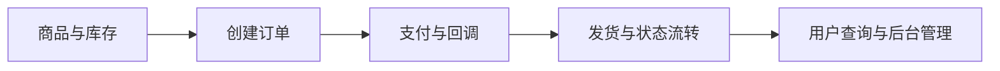

# 从下单到交付的全栈业务链路 · 工程导读

面向虚拟商品交易，将用户前台、管理后台与 Go API 连接到商品、订单、支付和发货流程。

## 先理解核心流程



## 值得深入的设计

- 前台、后台与服务端按职责拆分，业务阅读从路由进入服务层，再到支付、持久化与异步任务。
- 订单与支付是不同状态链：重点检查回调验签、重复通知、状态变更与异常补偿的具体实现。
- 多渠道和异步任务增加了失败场景，展示功能之外，还需要以隔离环境验证完整交易路径。

## 沿源码验证能力

1. **[API 路由](../api/internal/router)**：沿此入口检查实际实现与调用关系。
2. **[业务服务](../api/internal/service)**：沿此入口检查实际实现与调用关系。
3. **[支付模块](../api/internal/payment)**：沿此入口检查实际实现与调用关系。
4. **[数据模型](../api/internal/models)**：沿此入口检查实际实现与调用关系。
5. **[管理控制台](../admin)**：沿此入口检查实际实现与调用关系。
6. **[用户前台](../user)**：沿此入口检查实际实现与调用关系。

## 最短运行路线

以下为仓库既有脚本或配置对应的命令。命令以类 Unix Shell 为例，在仓库根目录执行；先准备所需服务和配置，不代表本次文档修改已经完成运行验证。

```bash
# 调整 docker-compose.yml 中的密钥、地址与数据配置
docker compose config
docker compose up -d
docker compose ps
```

## 一次演示应验证什么

1. 当前 Compose 暴露 API 8000、用户前台 8001、管理后台 8002；本地源码开发端口与此不同。
2. Compose 拉取发布镜像；核对镜像版本与配置格式，不将它视为当前分支源码构建的证明。
3. 先验证管理登录、商品建立与测试订单，再使用支付渠道的测试环境检查回调和交付。

## 当前边界与复现条件

- 支付与通知必须使用自己的测试配置；未进行真实交易验证时，不对资金正确性或性能作承诺。
- 前端运行时环境变量能否覆盖构建配置，应以对应镜像实现为准。
- Go 后端与 TypeScript 前端不是端到端共享类型，需要核对 API 契约。

## 继续贡献

建议从最小可复现场景开始：描述输入、预期输出、实际结果、运行版本和相关日志，再提交 Issue 或针对对应模块的 PR。测试与性能结果需注明实际执行环境；不要仅根据功能列表推断生产可用性。

[返回项目首页](../README.md)
